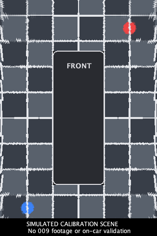

# DIY 360 prototype

This implements a live bird's-eye ground view from the existing four-camera
surround composite. It does not retrieve the factory stitched view. The factory
feed investigation remains on `research/factory-360-view`; this implementation
is on `feature/diy-360-view`, for integration into the fork's `main`.

## Use

**Vehicle illustration:** Settings → 360° camera → Picture offers Auto, 009,
7X or Generic outline, plus Green/White/Black colours. The choice is cosmetic,
applies to main/popup/photos and survives calibration reset. Auto uses positive
vehicle identity or the explicit 009 mapping/image-fit, otherwise an outline.
7X artwork is available, but actual 7X projection/performance still need vehicle
testing. Use Manual projection there; see [the evidence checklist](7x-360-validation.md).

**009 image fit:** Settings → 360° camera → Calibration → Projection profile
offers Manual (the existing default) and 009 image fit (experimental). The latter
uses fitted ray/plane transforms for all four cameras rather than the generic
mount defaults. It applies to main/popup rendering and stitched-photo exports;
manual lens values are retained. Its footprint/reference scale is fixed and its
own margin defaults to 3 and is limited to 0.5–3 reference units. This separate
setting initially widens existing fitted views on upgrade, while retaining the
Manual margin. Lower values zoom in; these are not measured distances. Source assignments and quality remain
adjustable. Reset returns to Manual. This improves image alignment against the
owner's 009 references, but is not measured distance calibration or a 7X preset.
See [evidence, reproduction and limits](009-image-fit.md).

This is an **experimental, uncalibrated view**. A connected vehicle interface is required, but preview and calibration do not require P or a particular speed. Reverse and factory-camera takeover still take priority. On the main live camera screen, tap **360°**. Tap **Four cameras** to return to
the usual preview. This is a manual, session-only display mode and is off at
launch. It does not automatically open on reversing or signalling. It is not
an overlay or HUD output. In the surround + cabin layout, only the surround
pane changes. Side windows, Super mirror and recordings retain their settings.

Hold the **360° / Four cameras** button to open **Calibrate 360 view**. Select
the physical camera to adjust. Calibration controls require a connected vehicle interface and an active screen; they close on interface loss or screen-off. Changes save automatically and update the preview;
**Reset all** resets only this prototype's calibration. The calibration is also
included in Diagnostics exports. Reset does not affect any other feature.

While the 360 view is selected, the main photo action exports the currently
fresh stitched preview as a PNG at the active resolution, with a companion calibration/state
TXT, under **ZeekrCompanion/Photos/360** on the configured storage. It includes the
selected 009/7X vehicle illustration or generic outline, and experimental watermark. A blocked, hidden or stale view is
refused; it never saves an old retained image as a current capture. Compression
and file writes run off the UI thread, with one save at a time and no queued
snapshots. The dedicated subfolder is outside the ordinary photo-playback list.
Return to **Four cameras** for normal photos and raw composite exports. Existing
recording and camera JPEG capture are unchanged.

### Resolution

Hold the 360 button and use **360 resolution** in the calibration dialog. The
saved choice applies to live stitching and exported PNGs. Balanced is the new
default when unset; Reset all restores it. For the owner's 1280×5140 stream:

| Mode | Readback | Stitched output | Maximum rate |
| --- | --- | --- | --- |
| Low | 256×1028 | 320×480 | about 15 fps |
| Balanced (default) | 768×3084 | 640×960 | 10 fps |
| Full | 1280×5140 | 960×1440 | 5 fps |

Balanced now retains 768 pixels per source camera side instead of 512, at the
same output size. This uses 2.25 times the source pixels and may lower actual
frame rate on the car; existing timing and memory fallbacks remain active.

The source aspect ratio, including separators, is retained. Full requests the
available live preview at its native dimensions, bounded to 8 million pixels
and 8192 pixels per dimension; it does not open another camera output or take
repeated JPEG photos. Small sources are not enlarged during readback. Actual
detail depends on the producer/live preview, and a larger bitmap cannot recover
detail already lost upstream. [TextureView copies/scales the available surface](https://developer.android.com/reference/android/view/TextureView#getBitmap(android.graphics.Bitmap)).

Repeated copies exceeding 40 ms or steady-frame extraction/render exceeding
150 ms first reduce cadence, and lower resolution only if sustained pressure
remains at the 250 ms interval limit. Allocation failure also reduces
Full → Balanced → Low for this activation. Low pauses
if it is still too slow. A toast reports reductions; Diagnostics and photo TXT
record requested/active mode, actual sizes, fallback reason and copy/render/lookup
timings, retained after leaving the preview. Changing calibration alone does not
retry a resolution that already proved slow; re-entering 360 or changing the
resolution choice retries it. Initial lookup construction is timed separately.
The first slow native copy cannot be interrupted; these are measured guards,
not proof that the first copy cannot stall. Higher modes still require car tests.

An active, recognized surround stream is required. For **CPU compatibility**,
GPU preview straightening must be disabled in Developer options, followed by an
app restart if it was enabled: a pre-corrected frame is not the input lens model.
The optional unreleased GPU 360 backend below uses the raw input and can coexist
with GPU preview straightening. The regular Canvas
straightening toggle may remain enabled; it does not modify the source snapshot.
The factory camera still owns priority; when it takes the camera, this view
cannot obtain new frames and displays **Waiting for live cameras**.

## Calibration

All defaults are estimates, not measured 009 geometry or factory calibration:

| Setting | Default |
| --- | --- |
| Vehicle length / width | 520 / 200 cm |
| Ground around vehicle | 200 cm |
| Camera height | 100 cm for each camera |
| Downward tilt | 35° |
| Heading, front / rear / left / right | 0° / 180° / 270° / 90° |
| Lens field of view | 190°, equidistant model |
| Lens centre | X 50%, Y 50% |
| Image rotation / horizontal flip | 0° / off |
| Mount offsets | X 0 cm, Y 0 cm |
| Source images, front / rear / left / right | Lanes 0 / 1 / 2 / 3 |

Base mounts are at the centre of the corresponding body edge. Positive mount X
moves right, positive mount Y moves forward. Side cameras will likely need a
forward mount offset, as their actual mounting position is not at the middle
of the vehicle. Image rotation, source selection and horizontal flip compensate
for firmware image orientation; these are independent of side-camera mirroring.

For a first adjustment, park on flat ground with visible pavement lines. Check
which image belongs to each camera (selection swaps assignments to keep all four distinct), then its rotation/flip, lens centre/FOV,
height and tilt, mounting position and heading. Align ground features across
seams. Manual adjustment is approximate: tomorrow's original composite frame
and geometry text can help identify orientation and cropping. Accurate
calibration subsequently needs known-size targets at measured ground positions.

## Implementation and limits

The main TextureView remains the camera consumer and continues its native draw
and update path. The prototype reads a snapshot of that entire existing
frame at the selected resolution/cadence, respecting the detected normalized lane boundaries
and separators. No new Camera2 surface, session or vehicle control is opened.

A single background-priority worker precomputes a lookup mapping each output ground point through
the camera pose and equidistant lens. Physical front/rear/left/right regions meet
at diagonals extending from the vehicle corners. Only a 20 cm wide corridor
perpendicular to each diagonal blends adjacent cameras; elsewhere a single
valid camera supplies the image. Source lane swaps do not change these physical
roles. If the preferred camera has no lens coverage, the strongest actually
observed alternative supplies the pixel; if none does, it stays black. The join
width is an estimated display choice, not a calibrated ground distance. It produces the selected output size,
scaled with uniform metres per pixel, and draws a masked vehicle outline with
its front indicated. Ground beyond the lens or behind a camera is rejected;
unobserved areas remain black rather than stretching source edges or inventing
pixels. Bilinear sampling reduces nearest-neighbour stair steps and validates
every contributing pixel, without sampling neighbouring lanes or separators.
Detail remains limited by the actual live source and active resolution;
interpolation does not recover missing detail or correct inaccurate calibration.

There is one frame in flight and no queue of old frames. New source timestamps
are required after attaching to a texture; a retained first frame is insufficient
to call the view live. If the observed source timestamp stops changing for 500 ms, the picture is covered with a waiting message. Configuration revisions
and texture identity invalidate pending results. Sampling pauses when the view
is hidden, stops when leaving 360 mode, and the worker closes on detachment.

This assumes a flat ground plane and an approximate lens model, with no measured
radial distortion coefficients or automatic target calibration yet. Tall objects
can stretch or ghost at seams. Mounting errors can leave gaps or misalign nearby
objects. Owner raw-frame reproduction also shows bodywork projected ahead of the
vehicle outline with the default front calibration. Narrow joins reduce broad
double images but do not fix that projection. Hiding or stretching the band
would not recover the ground concealed by the bodywork. The partial image-based
front/rear fit remains offline; neither side has sufficient inspected reference
correspondences for an independently checked fit. No fitted calibration is
installed by this change. The per-mode frame cap, readback overhead, actual texture orientation,
performance during recording, native layout and camera takeover/recovery need
009 testing. This is an experimental calibration preview, not a factory-quality
parking view or distance measurement.

The geometry and compositing are original fork work, built on dts88's surround
preview and its contributors' composite-stream layout infrastructure. This is
not an import of Ferix's HUD or any third-party surround stitcher.

## Local verification

`BirdEyeProjectionTest` covers optical-axis alignment, front/rear handedness,
left/right headings, rotation/mirroring, invalid lens coverage, vehicle masking,
correct camera colours, narrow seam blending, physical camera roles after lane
swaps, observed-camera fallback, separator exclusion, squeezed
HAL geometry, invalid calibration and mismatched buffer rejection.

[BirdEyeFixture](../tools/BirdEyeFixture.java) generates four simulated fisheye
images of a ground grid and projects them through the actual app renderer. Its
PNG is synthetic verification, not a screenshot from a 009. The reconstructed
grid and coloured landmarks stay aligned across the four views. Desktop timings
do not predict head-unit performance. No vehicle, emulator or actual Android
TextureView readback was available for this build.

The safety follow-up blanks the view on known factory-camera/reverse/park-assist
activity, missing texture, hidden/dark screen or invalid calibration. Tick checks
run every 100 ms; this is not a hard real-time deadline. A measured UI-thread
camera readback over 40 ms now reduces resolution, and pauses at Low if still
too slow. This prevents repeated copies at a resolution that proved slow, but
cannot interrupt the first slow native call.

The bitmap is cleared to transparent before every copy, since Android may silently
leave a destination bitmap unchanged on failure. Any transparent sampled pixels
reject the entire result; failed copies cannot reuse old destination pixels.
Texture timestamps must advance strictly; zero, regressions, identity changes
and resumes require a new baseline. Producer exposure age and individual-camera
freshness inside the composite are still not independently verified.

See [the safety review](camera-safety-review.md) for findings and remaining limits.

## Owner comparison, 2026-10-15

The owner supplied two original four-camera composites, a factory 360 photo and
a photo of the prototype. The prototype matches an offline reproduction of the
estimated defaults: the broad front/rear scene placement agrees, but ground and
seams are distorted. The four 1280×1280 source lanes and separator geometry agree
with the raw notes. Side rotations, forward side-camera mount offsets and
height/tilt variations were rendered offline; none establishes a reliably
calibrated replacement from this dark scene alone. Side-popup screen rotations
should not be blindly substituted for the optical pose parameters. Defaults are
retained until useful ground correspondences or measurements support a fit.
Sampling/export improvements therefore do not resolve the geometric mismatch.

## Preview pacing follow-up (2026-10-15)

The owner's 2.11.25 Diagnostics retained a 4 ms readback and 18 ms render at
Balanced after leaving the preview. That sample is not a sustained benchmark,
but the old 200 ms interval itself limited Balanced to 5 fps. New target
intervals are 67/100/200 ms at Low/Balanced/Full with unchanged image dimensions.
A deadline-based timer and worker-completion wakeup avoid another fixed 100 ms
poll after work. Busy/blocked paths retain 100 ms checks, and overdue work has
a 16 ms backoff. Unchanged producer timestamps skip duplicate readback/render.

Only one frame can be in flight; existing memory/timing downgrade, source expiry,
geometry and factory-camera guards remain. The UI-thread TextureView readback
and CPU stitcher remain, so this is not a GPU renderer or factory feed. Higher
targets can increase load; delivered performance on the 009 is still unverified.
Diagnostics include captureIntervalMs and presentationGapMs alongside copy/render
times. The last measured presentation gap remains available after leaving the
preview, and is reset on a new activation or quality change. Check these and
concurrent recording at each quality setting.

## Popup window and dedicated settings (2026-10-15)

### Expanded bounds correction (2026-10-18, unreleased)

The owner supplied photos showing extra space below the expanded DIY 360 popup
over Android Auto. Expansion had used app resource display height, which need not
match the area available to a service-owned overlay. Android 11+ now uses current
window bounds minus visible system bars/cutouts, matching the window's inset-fit
policy. Hidden bars are not reserved. The API 28–29 fallback uses the attached
window's visible frame, with resource metrics only before attachment.

Expansion retains the 2:3 shape and small 8dp margin. Insets/configuration changes
refit the expanded picture without collapsing it or saving expanded geometry;
Restore recalculates normal geometry from the saved size/position. Drag and pinch
use the same area. System bars reported by the head unit remain respected; this
does not suppress or force-cover vehicle controls. Diagnostics include the popup
viewport, requested rectangle and measured size. The Android Auto/009 firmware
behavior still needs a vehicle check; software geometry checks are not proof of
the exact cause on that installed build.

Android documents that [current window metrics](https://developer.android.com/reference/android/view/WindowManager#getCurrentWindowMetrics())
include bounds and separate insets; [inset fitting](https://developer.android.com/reference/android/view/WindowManager.LayoutParams#setFitInsetsIgnoringVisibility(boolean))
can respect their current visibility. The implementation uses both consistently.

Validation: 1,480 JVM checks, nine Android window/control checks, lint and
debug/release assembly passed. Native regressions shorten app resource height,
change reported insets while expanded and verify the actual on-screen bottom
edge, retained aspect ratio and saved normal placement. Emulator screenshots
confirm the software bounds; Android Auto on the 009 and the API 28–29 fallback
have not been validated on a vehicle/device with those conditions.

Settings → 360° camera contains the live popup switch, quality, popup size,
popup-layout reset, calibration and
calibration/quality reset. Holding the main 360° button still opens calibration.
Popup placement uses a separate store; calibration/quality reset does not reset
popup placement, mirror/side-view preferences or the selected display mode.

The service owns its own TextureView and runs the same bounded CPU renderer and
freshness policy while the app is minimised. Opening from MainActivity returns
the main preview to the grid so there is only one visible DIY renderer. X closes
the runtime window without changing the selected display mode. There is no
automatic boot/indicator opening or sticky service restart. While the popup is open, Take
photo uses the fresh popup render and refuses suspended/stale pictures.

BIRD_EYE is a separate surround-only camera holder/output. It shares the existing
preview hardware stream; adding/removing it may rebuild that camera session. It
is last among preview surfaces, yields at the shared-surface limit, and is the
first optional output removed on asynchronous configuration failure. Synchronous
session-creation exceptions also yield it before retrying. Removing it leaves
mirror, side view and recording declarations intact. These policies do not
establish zero recording gaps on an actual HAL; test continuity and all active
window combinations on the car. A rejected output closes the popup and reports
the limitation rather than repeatedly retrying it.

Factory cameras, reverse, screen-off, a disconnected vehicle and an exclusive
developer probe detach the popup/release its claim. It can resume when those
conditions clear while its explicit runtime request remains active. Closing/X or
Exit ends that request. The prototype remains uncalibrated; there is no P-only
or speed eligibility rule. System-themed corner controls reuse the side popup’s
48 dp controls. Loading/status notices wrap in the narrower window.

`BirdEyeRawFixture` renders a private original 1280×5140 composite through the
actual Java renderer, using the exported four-pixel separator geometry. It makes
local before/after verification possible without substituting a phone screenshot
or a straightened image for raw camera pixels. Keep inputs and results private;
the supplied 009 daytime comparison verifies reduced overlap, not calibration
accuracy or ground distance. The front bodywork band remains a known limitation.

## Explicit main-page actions — 2026-10-18

The main-page **360 view** action always selects DIY 360 in the main preview;
**Windows → 360 window** toggles the independent manual window. Opening the window
returns the main preview to its grid, and selecting main 360 closes the window,
retaining the existing single-visible-renderer behavior. The legacy
main/popup shortcut-destination setting is no longer exposed because the actions
are explicit; its stored value and window geometry are retained. This does not
change projection, calibration, capture resolution, factory yielding or recording.
The window still requires the mapped Surround source to be available.

## GPU renderer (unreleased, 2026-10-19)

A separate **360° rendering → GPU (experimental)** choice is now implemented for
main and popup, with CPU compatibility retained by default. Quit and reopen to
change the camera preview route. GPU mode uses the raw camera texture and the
same projection lookup; it does not snapshot/upload a bitmap each live frame.
It can coexist with the Developer GPU preview-straightening setting: while 360
owns the preview, it uses the original camera texture, then restores the prior
four-view correction on exit. The earlier GPU-blocking instruction above applies
to the CPU backend trying to read a corrected preview.

See [GPU pipeline, fallback, validation and limits](gpu-360-renderer.md). Alpha 53
does not contain this new path. Car frame rate, hardware support, thermal load and
recording continuity remain to be checked.

## CPU rendering efficiency (2026-10-19)

The pixel-preserving packed lookup/sampler and single-camera fast path reduce
synthetic Android rendering cost and lookup memory without lowering quality.
Diagnostics now separate worker queue, output publication and total processing.
UI-thread TextureView copying and the existing per-quality frame caps remain;
vehicle smoothness still needs measurement. See [benchmark and limits](360-render-performance-2026-10-19.md).

## Half-screen expansion (unreleased, 2026-10-20)

The 360° popup uses the same temporary portrait half-screen expansion as the
blind-side popup. It fills the usable overlay height and half its width, with
control margins, anchored to the half nearest its normal position. On extremely
wide displays width is capped at height. Restore returns the exact normal size
and position. Native bounds/inset changes continue to refit the expanded panel
without saving its geometry. The stitched picture retains its proportions inside
the panel; calibration, capture resolution, camera routing and recording do not
change.

Validation for the half-screen follow-up: all 1,516 JVM tests, debug/test builds
and lint (zero errors) pass. Three native API 32 tests cover shortened app metrics,
inset changes without losing expansion, exact restoration, retained preferences,
drag and Close. Native screenshots confirm half-screen bounds and reachable corner
controls; the emulator has no vehicle camera feed. Logs:
`/tmp/companion-360-half-build.log`, `/tmp/companion-360-half-native.log`.
